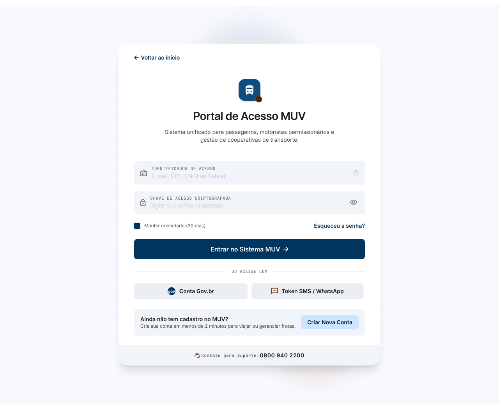
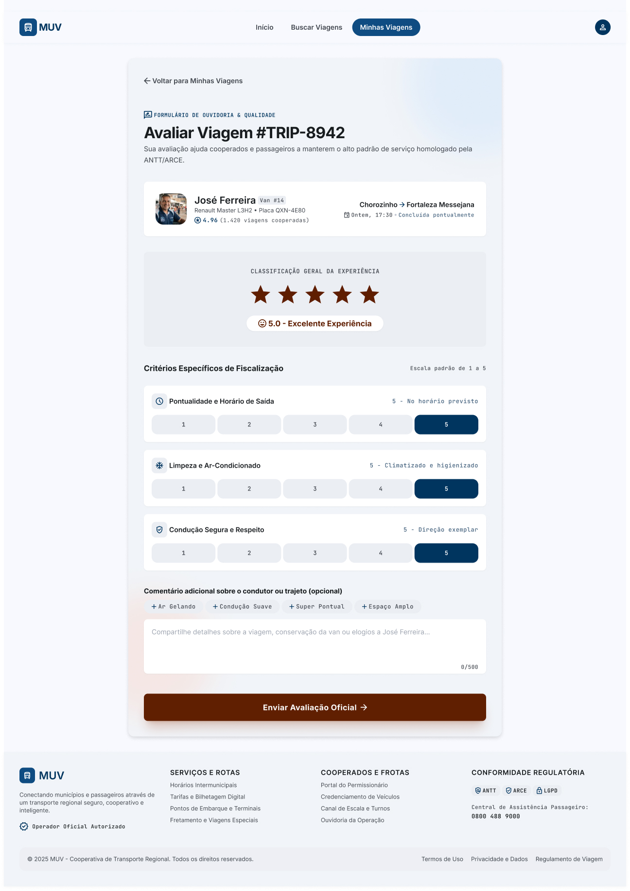

# 📱 Protótipo de Sistema de Transporte (MUV)

Este documento faz o mapeamento e a referência visual de todas as telas que compõem o fluxo do protótipo de alta fidelidade do sistema **MUV**.

Link para o protótipo: [Protótipo MUV - Figma](https://www.figma.com/proto/BZfLRVcLOKqP6gbZbNptuF/MUV---Prot%C3%B3tipo?node-id=0-1&t=VshrSIOtUozd4sBd-1)

---

## 🛠️ Autenticação, Cadastro e Configurações

### 1. Tela Inicial
Tela de boas-vindas do aplicativo com as opções principais de login ou criação de nova conta.

### 2. Autenticação
Formulário de login para usuários já cadastrados acessarem a plataforma.

### 3. Cadastro - Passageiro
Fluxo de criação de conta e inserção de dados pessoais para usuários passageiros.

### 4. Cadastro - Motorista Individual
Fluxo de cadastro para motoristas autônomos, incluindo envio de documentos e dados do veículo.

### 5. Cadastro - Cooperativa
Fluxo de cadastro corporativo para frotas e cooperativas parceiras.

---

## 🗺️ Fluxo do Passageiro

### 6. Início do Passageiro (Área Autenticada)
Painel principal do passageiro após o login, mostrando o mapa e atalhos de navegação.

.jpg)

### 7. Buscar Viagens (Passo 1: Seleção de Viagem)
Tela de busca onde o passageiro define origem, destino, data e visualiza as rotas disponíveis.

### 8. Seleção de Assento & Reserva (Passo 2)
Interface interativa para o passageiro escolher o assento desejado dentro do veículo selecionado.

.jpg)

### 9. Detalhes da Viagem & Itinerário Completo
Resumo da viagem reservada, exibindo horários, paradas e o trajeto detalhado.

### 10. Histórico de Viagens - Passageiro
Listagem de todas as viagens anteriores realizadas pelo passageiro, com status e recibos.

### 11. Configurações da Conta do Passageiro
Área de gerenciamento de perfil, formas de pagamento e preferências do passageiro.

---

## 🏢 Fluxo da Cooperativa e Gestão de Frota

### 12. Painel Geral - Cooperativa
Dashboard principal da cooperativa com métricas de desempenho, faturamento e visão geral da operação.

### 13. Gestão de Frota - Cooperativa
Painel de controle e monitoramento de todos os veículos associados à cooperativa.

### 14. Avaliações da Frota - Cooperativa
Relatórios de feedbacks e notas dadas pelos passageiros aos veículos e motoristas da cooperativa.

### 15. Configurações Operacionais da Cooperativa & Motorista
Ajustes técnicos, regras de negócio e parametrizações do sistema da cooperativa.

---

## 🎛️ Painel do Motorista e Operações

### 16. Gestão de Motoristas
Tela de monitoramento, ativação, bloqueio e dados dos motoristas cadastrados.

### 17. Gerenciamento de Veículo
Detalhes de um veículo específico, incluindo status de manutenção, documentação e histórico.

### 18. Registro Manual - Motorista
Interface para que o motorista ou operador registre viagens e jornadas de forma manual.

### 19. Detalhes Viagem - Cooperativa
Visão detalhada de uma viagem específica sob a ótica da cooperativa.

---

## 📈 Relatórios, Suporte e Alertas

### 20. Relatório de Demanda
Gráficos e dados analíticos que indicam os horários e locais de maior procura por viagens.

### 21. Achados e Perdidos
Módulo de suporte para registro e devolução de itens esquecidos nos veículos.

### 22. Avaliação
Tela onde o usuário atribui notas e comentários após a finalização de uma corrida.

### 23. Página de Alerta
Tela de erro, aviso do sistema ou notificação crítica emitida para o usuário.

